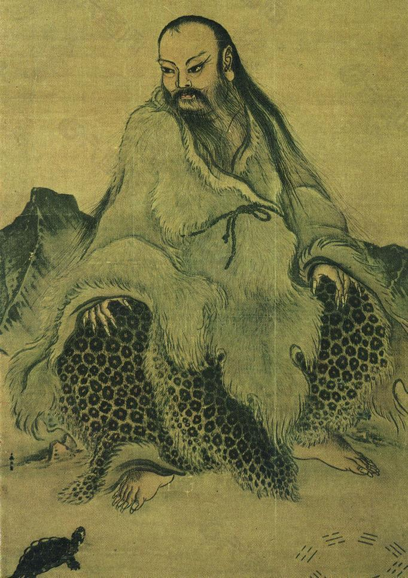
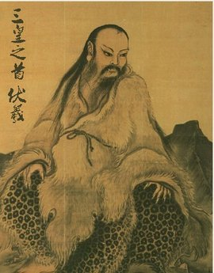
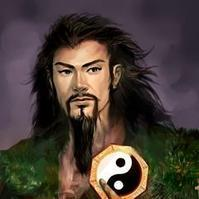
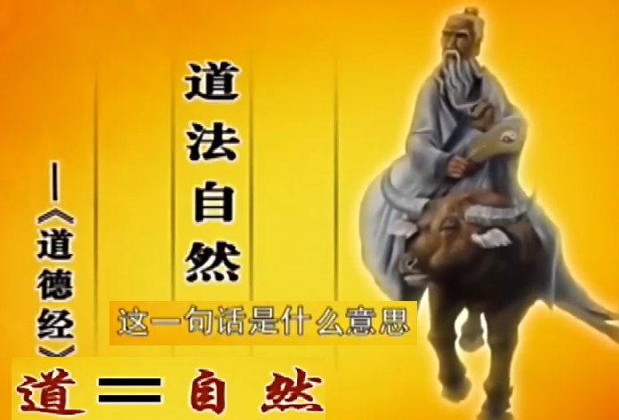
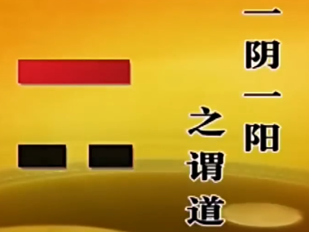
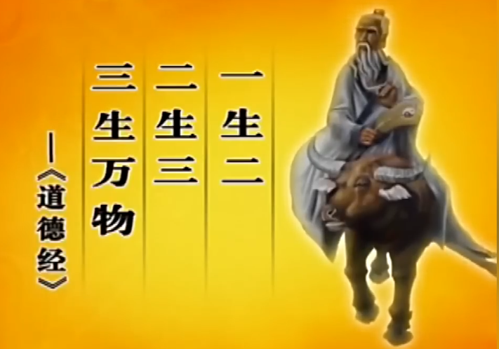
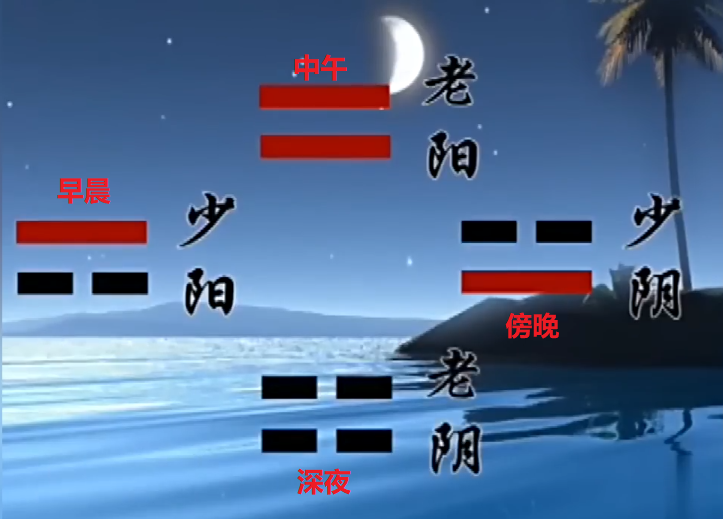
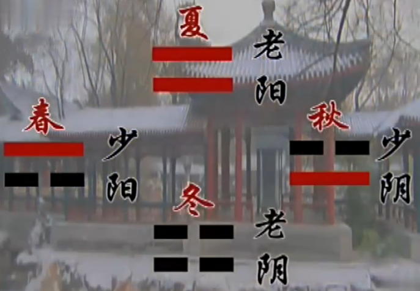
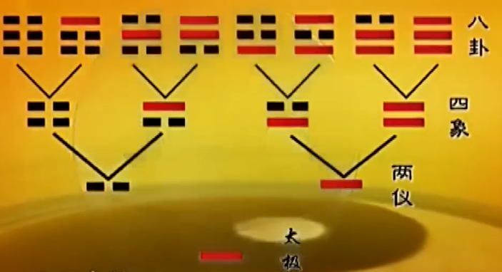

# 易经——阴阳之道

## 伏羲氏

## 古老中国哲学思想的起源

## 老子

### 道可道，非常道

### 道法自然

## 孔子

### 吾道一以一贯之

## 易经： 一阴一阳之谓道

# 阴阳之道

## 哲学

### 中西方

#### 都来源于神话

#### 中国来源于阴阳之道

#### 西方主要观点为二分法

#### 神话、哲学都是解答宇宙人生的问题

## 易经带给我们的是智慧

## 易经告诉我们一切一切都是人想象出来的
## 天机————指想象出来的东西
### 嗜羽深者天机浅，嗜欲浅者天机深

## 伏羲（图片）

  
  
  

## 阴阳

### 观察自然现象

#### 太阳每天东升西落，一定存在一种力
#### 显然不合理，因为没有那么多的太阳每天东升西落，因此要反省

#### 太阳东升表示存在一向上拉升的力

#### 太阳西落表示存在一种向下拉的力

### 思考想象

#### 太阳东升西落表明存在两种互动的力量：一正一反、一上一下

### 表述（绘制，文字的缺失）
#### 一画开天辟地，太极即一画 

##### 一阳：阳用一横线表示，一根树枝

##### 一阴：阴用一间断的横线表示，一根折断的树枝

#### 太阳东升西落是循环往复，周而复始

### 进一步提升思考

#### 阴阳互存的（不是相互转化的，这就是与西方思维的不同），阴阳即两仪

#### 阳中有阴

#### 阴中有阳

#### 阴极成阳

#### 阳极成阴

#### 阴阳运动是协调的，相互配合的（宇宙存在规律的，乱中有序的）

#### 一阴一阳之谓道，自然的变化就是阴阳之道（孔子所言，所加），世界上万事万物都是自然孕育的

### 孔子：易有太极，事生两仪。一生二，二生三，三生万物。
### 老子：道法自然

一阴一阳之谓道
### 中西方差异
#### 西方：一分为二，阴就是阴，阳就是阳
### 中方：一生二，一（阳）分开生成二（阴），即阳中有阴；二（阴）合为一（阳），即阴中有阳

