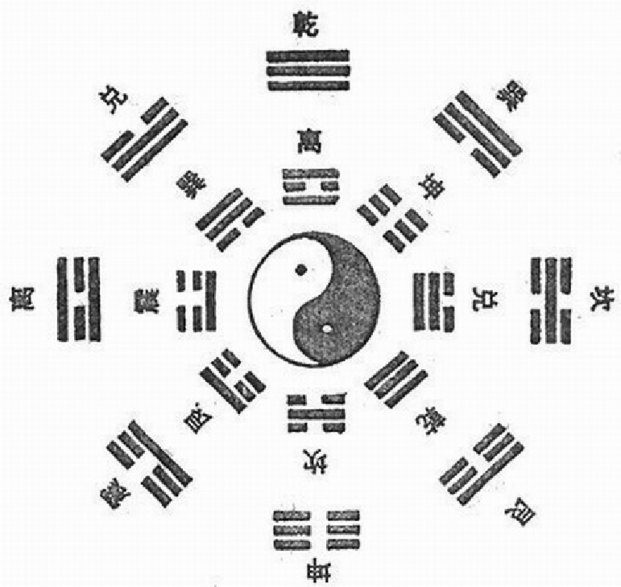
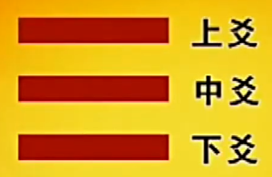
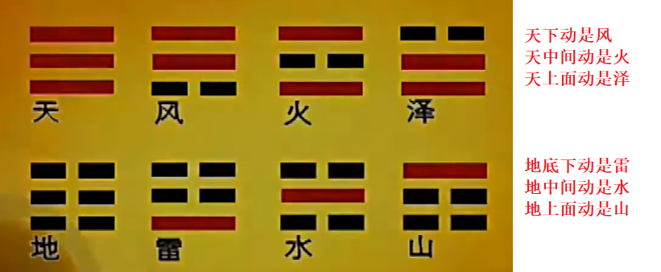
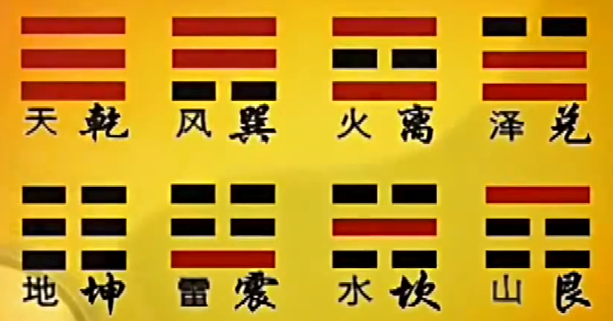
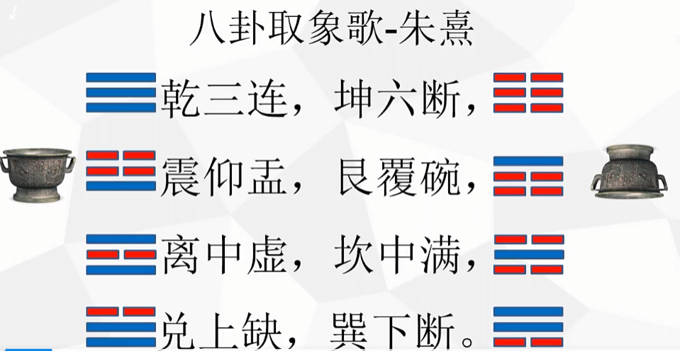

# 易经——八卦定乾坤
## 八卦就是易经,易经就是八卦
## 8种基本的元素(相对的)

### 天有关
#### 天（上）

### 地有关
#### 地（下）

#### 水（生存：离不开）
#### 火（生存：食物、热）

#### 风（解热靠风）
#### 雷（与风相对）

#### 山（风来自不同方向）
#### 泽（山的那边就是海、湖）

### 8种基本元素是可相互作用的
#### 雷风互动
#### 雷山互动
#### 雷天互动
#### ……
#### 互动就是八卦

## 天（阳）地（阴）
### 分别用一条线表示（即两仪）
### 天上有天，地下有水……，一条线表示不完整就有了三条线————卦

## 八卦(八种基本元素之间的互动)
### 与天有关（阳）的子系统
### 与地有关（阴）的子系统

### 构成（卦象）：三条线表示
### 爻：一条线就称为爻，三条线分别为上爻、中爻、下爻。爻含有变动、仿效之意，

# 八卦形成
## 三个阳爻代表天（乾）：意为刚健，恒久的刚强
### 天下动是风，意为无孔不入，用巽(xun)表示
### 天中间动是火，意为烧尽，用离表示
### 天上面动是泽（观察天的在水中的倒影，因为天上面是无法观察的），意为喜悦，用兑表示

## 三个阴爻代表地（坤）：意为柔顺
### 地底下动是雷，意为震动，用震表示
### 地中间动是水，用坎表示，意为欠土
### 地上面动是山（高度想象），意为遇山要止，用艮（gen）表示

## 朱熹的八卦取象歌(理解八卦形成更好记忆)

### 乾三连，坤六断，
### 震仰孟，艮覆碗，
### 离中虚，坎中满，
### 兑上缺，巽下断
# 八卦的含义
## 每个卦由6个爻构成，每个爻可是可变的，一切都是动态的，世界上一切事物都是变动的，人的命运也是变动的。
## 万变不离其宗（一即太极）