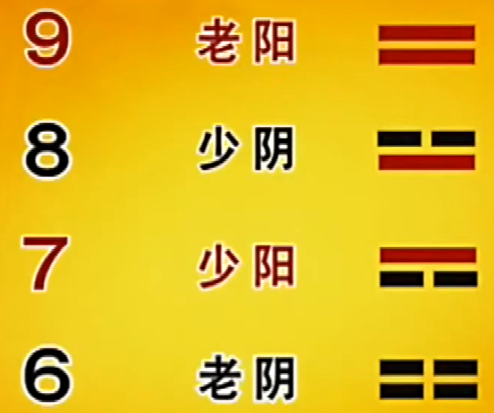

根据占卜的结果找到我应该采取哪一种迂回、采取哪种趋吉避凶、把损害减到最小的那种方式去做，这是占卜的意义

# 占卜（用途）
## 占卜结果只能供作参考
## 寻找趋吉避凶，损害减到最小途径
## 旁观者清，认清此时此地的你，对占卜的卦进行解卦
# 占卜与人的品性、时空有关，不同的人不同时空，可能结果不同

# 道德是最高的修养

# 卦的基本概念
## 1234推出6789游戏
### 一个铜板有正反两个面，即1、2
### 三个铜板，即3
#### 假设正面为3，反面为2
#### 只有4种变化，即4
#### 出现的情况：
##### 情况1：正面 正面 正面
###### 3+3+3=9；叫老阳
##### 情况2：正面 正面 反面
###### 3+3+2=8；叫少阴
##### 情况3：正面 反面 反面
###### 3+2+2=7；叫少阳
##### 情况4：反面 反面 反面
###### 2+2+2=6；老阴

## 变化
### 七上八下（一天的变化）
### 阳九阴六（易经中固定的符号）
### 阳是扩散的，阴是收缩的
### 阳——奇数，阴——偶数
### 爻：时（时间）；位（空间）；性质（阴阳）
### 卦
#### 从下到上去看
#### 分为 下卦和上卦
#### 标识：阳9阴6，如初九，九三，上六，上九……，其中初九的初表示时间，九三的九表示位置空间，初始时时间比空间重要，成长后空间比时间重要
#### 卜卦的方法
##### 占卜一次，结果必然是6、7、8、9之一
#### 记录规则为阳9、7，阴为8、6；记录方向：由下而上
#### 绘制的六条爻，看成一个整体，即一卦

