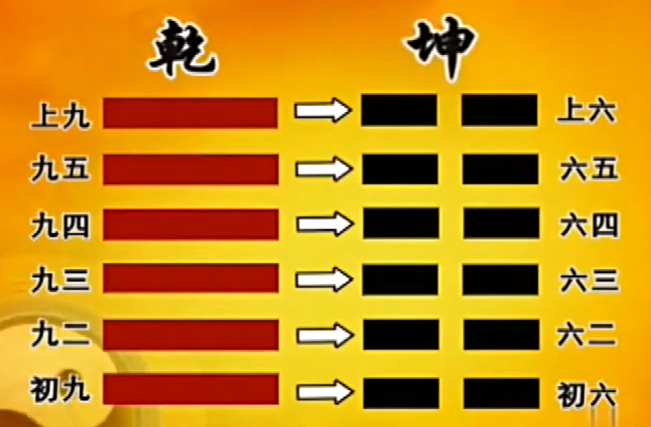
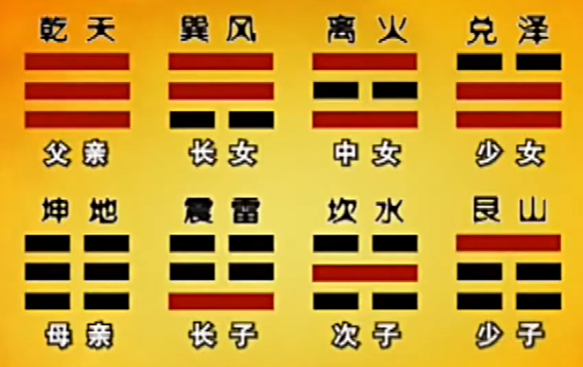
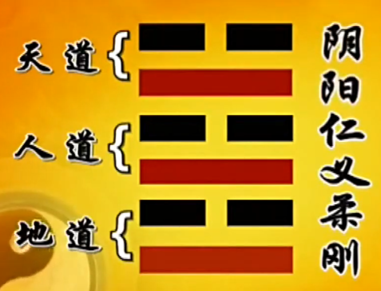
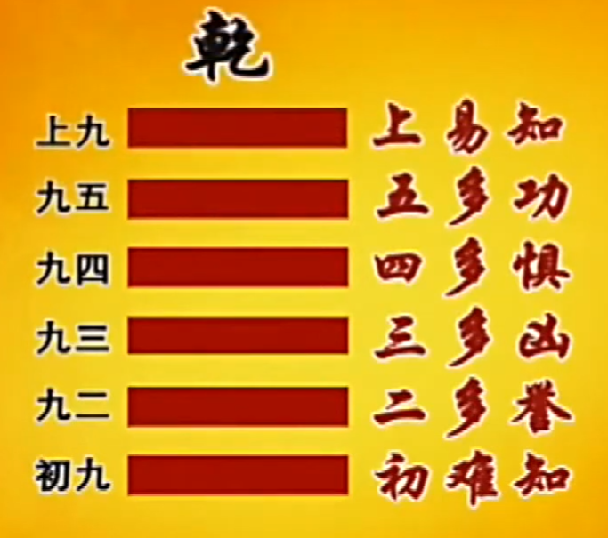

天地是宇宙的基础，而易经中的乾坤两卦也是开天辟地的两扇大门。
# 乾卦（纯阳，1个）
## 构成
### 六个爻都是阳的
### 名称
#### 初九
#### 九二
#### 九三
#### 九四
#### 九五
#### 上九
## 含义
### 天、父
### 与乾卦关联的巽（风）、离（火）、泽（兑）表示长女、次女、小女

# 坤卦（纯阴，1个）
## 构成
### 六个爻都是阴的
### 名称
#### 初六
#### 六二
#### 六三
#### 六四
#### 六五
#### 上六
## 含义
### 地、母
### 与坤卦关联的震（雷）、坎（水）、艮（山）表示长子、次子、小子

# 错卦（乾坤（阴阳）交错，62个）
# 单卦（三画）
### 从上向下表示：天、地、人

# 重卦（六画）

### 三画卦每画用阴阳表示，则为天道（阴阳）、地道（仁义）、人道（刚柔）
### 分为上下两个单卦：下卦为物质，上卦为能量
### 每个爻所在的位置即位阶，单数为阳，偶数为阴，位置由下而上标注
### 若位阶为阳，爻也为阳，则为当位，反之不当位。只有第63卦——既济卦，六个位置全是当位的；完全不当位的仅仅1个——第64卦（未济）
### 位阶的含义（通用规则）——一定有例外

#### 位阶1：初难知
#### 位阶6：上易知

#### 位阶2：二多誉
#### 位阶5：五多功

#### 位阶3：三多凶
#### 位阶4：四多惧

### 人际启发
#### 功归为位阶5，不要和领导抢功劳
#### 位阶1时，多观察，少言语
#### 位阶2时，多争取
#### 位阶3时，多考虑能上能下
#### 位阶4时，是否适可而止
