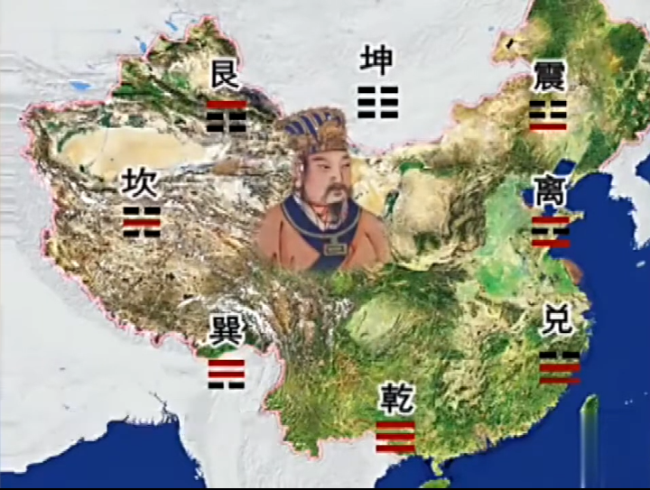
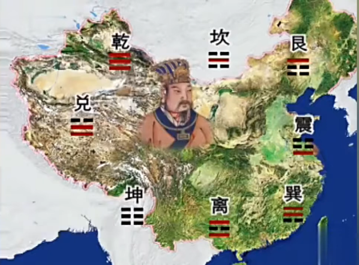

# 坤卦
## 乾坤
### 卦辞
#### 元亨利贞
### 自强不息
## 坤卦
### 卦辞
#### 元亨利贞，元亨利牝马之贞
##### 牝马——母马
##### 牡马——公马
##### 为什么用马不用牛？因为马忠贞不二，坚持合理的原则
### 厚德载物
#### 厚德载物指道德高尚者能承担重大任务，也指有德行的君子，应该以深厚的德行，来容载世间的万物。
#### 是指甘心做好配角，辅助、配合主角完成任务
### 夫唱妇随、龙马精神————夫、龙把握正确的方向、合适的速度，排除途中障碍，妇、马跟随就好，不给主角带来任何麻烦

### 坤卦爻辞
#### 初六
##### 履霜坚冰至，即趁早预先防范，或遏制，或躲避
#### 六二
##### 站的低，自然看到的地是方广大，地是明（天是光，地不是发光体，只能反射光）
#### 六三
##### 含章可贞，无成有功
##### 合理的部分就去尽力完成，不合理的部分，了解后要进行反馈，做了事情不能算是你的功劳
#### 六四
##### 此时听到领导不对别人说的话，不让别人做的事。你不可多嘴（把领导的话告诉他人），做一些领导不能做的事。
##### 关键点是不给领导留下任何后遗症，而且你还得不到褒奖。
##### 所以，谨言慎行，少惹事，还要不怕事
#### 六五
##### 善于做协调，注意不可功高盖主。
#### 上六
##### 此时应该知道九五的很多秘密，应明白伴君如伴虎。
##### 适可而止，量力而为（明白自己就是一匹牝马）
##### 持久是最求的目标，做大做强不可一味追求，那是九五的目标

